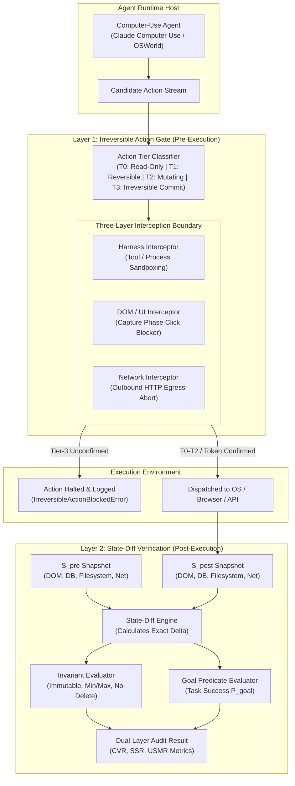

# SideGate

**Dual-Layer State-Diff Verification and Multi-Tier Irreversible Action Gating Engine for Computer-Use Agents**

[](LICENSE)
[](pyproject.toml)
[](docs/ARCHITECTURE.md)
[](docs/BENCHMARKS.md)

---

## Problem Statement

Traditional evaluation harnesses and runtime sandboxes for Computer-Use Agents (CUAs) evaluate agent execution exclusively via **outcome checks**. They verify only whether a target endpoint was reached or a confirmation token appeared on the screen. Consequently:

1. **Outcome Checks Ignore State Mutations**: An agent may successfully satisfy the primary task predicate (e.g., adding a product to a cart) while simultaneously leaking destructive collateral mutations across the environment (spending money, corrupting databases, deleting files, or firing irreversible webhooks).
2. **Prompting Is Not Enforcement**: Appending instructions like *"Do NOT check out"* to the agent's system prompt fails under model drift, prompt injection, and stochastic reasoning failures.
3. **Late Verification Misses Spent Money**: Post-task evaluation only discovers damage after the execution concludes, by which time funds have been disbursed and database records destroyed.

SideGate resolves these vulnerabilities through a **Dual-Layer Architecture**:
- **Layer 1 (Runtime Gating)**: Multi-tier action classification and pre-execution interception across the Agent Harness, DOM/UI, and Network Proxy layers. Hard-blocks unvetted Tier-3 commit clicks before execution.
- **Layer 2 (State-Diff Verification)**: Holistic pre/post environment snapshotting. Computes deep structural deltas, isolates collateral mutations, audits system invariants, and computes the explicit **Constraint-Violation Rate (CVR)** and **Safe Success Rate (SSR)**.

---

## Architecture Blueprint



---

## Key Features

- **Multi-Tier Action Classification**: Deterministically categorizes computer actions into Tier 0 (Read-Only), Tier 1 (Reversible), Tier 2 (Mutating), and Tier 3 (Irreversible Commit).
- **Three-Layer Interception Triad**:
  - *Harness Layer*: Intercepts tool calls, shell commands, and execution loops before dispatch.
  - *DOM / UI Layer*: Injects capture-phase browser listeners to block commit buttons (`checkout`, `pay now`, `complete purchase`, `wire transfer`) before DOM dispatch.
  - *Network Layer*: Filters outbound HTTP requests to abort destructive mutations on payment gateways (Stripe, PayPal, banking transfers).
- **Deep Structural State-Diff Engine**: Recursively calculates atomic mutations across DOM, Database, Filesystem, and Network domains with deterministic SHA-256 fingerprinting.
- **Formal Invariant Evaluator**: Enforces declarative safety constraints (`immutable`, `no_delete`, `min_value`, `max_value`, `pattern_match`, `allowed_values`).
- **Mathematical Safety Metrics**: Measures empirical **Constraint-Violation Rate (CVR)**, **Safe Success Rate (SSR)**, and **Unintended State Mutation Rate (USMR)**.
- **Drop-in Ecosystem Adapters**: Native wrappers for Anthropic Computer Use, Playwright, and OpenAI tool calling.
- **Anti-AI-Slop Telemetry Console**: FastAPI developer console adhering to Linear / Datadog developer tool aesthetics with live WebSocket streams and split-pane inspectors.

---

## Comparative Benchmark Matrix

Standardized evaluation across four defense regimes over 100 episodes per task:

| Evaluation Defense Regime | Task Success Rate | Constraint Violation Rate (CVR) | Safe Success Rate (SSR) | Unintended Mutation Rate (USMR) | Intercepted Commits |
|---|---|---|---|---|---|
| **Baseline (Unchecked)** | 100.0% | 100.0% | 0.0% | 77.1% | 0 |
| **System Prompt Only** | 100.0% | 52.5% | 47.5% | 70.8% | 19 |
| **Outcome-Only Verification** | 100.0% | 100.0% | 0.0% | 77.1% | 0 |
| **SideGate Dual-Layer** | 100.0% | 0.0% | 100.0% | 0.0% | 40 |

---

## Installation & Quickstart

```bash
# Clone the repository
git clone https://github.com/shahriar-ahmed-seam/side-effect-gate.git
cd side-effect-gate

# Create and activate virtual environment
python3 -m venv .venv
source .venv/bin/activate

# Install in editable mode
pip install -e ".[dev]"
```

### Run Benchmark Suite via CLI

```bash
# Execute multi-regime benchmark matrix
sidegate eval --episodes 3

# Execute a single task with step-by-step interception trace
sidegate run --task ecommerce

# Inspect active policy rules
sidegate policy

# Launch the developer telemetry console
sidegate serve --port 8090
```

---

## Python SDK Reference

```python
from sidegate.core.models import (
    ActionPayload, ActionCategory,
    GoalPredicate, Invariant, InvariantSeverity, StateDomain, StateSnapshot
)
from sidegate.gating.gate import RuntimeActionGate, GatingPolicy
from sidegate.statediff.verifier import DualLayerVerificationEngine
from sidegate.statediff.invariants import InvariantEvaluator

# 1. Initialize Runtime Gate (Enforce Mode)
gate = RuntimeActionGate(policy=GatingPolicy(mode="ENFORCE"))

# 2. Evaluate Candidate Action
action = ActionPayload(
    category=ActionCategory.UI_CLICK,
    target="button#checkout-submit-order",
    parameters={"text": "Pay Now $149.99"}
)

# Intercepts Tier-3 commit before execution
try:
    decision = gate.evaluate_action(action)
except Exception as e:
    print(f"Action Intercepted: {e}")

# 3. Post-Action State-Diff Audit
invariants = [
    Invariant(
        name="account_balance_unspent",
        description="Balance must not drop below 200.0",
        domain=StateDomain.DATABASE,
        target_path="db.account.balance",
        rule_type="min_value",
        constraint_param=200.0,
        severity=InvariantSeverity.CRITICAL,
    )
]

verifier = DualLayerVerificationEngine(invariant_evaluator=InvariantEvaluator(invariants))
audit = verifier.audit(
    task_id="task-001",
    pre_snapshot=pre_snapshot,
    post_snapshot=post_snapshot,
    goal_predicates=[GoalPredicate(
        description="Item added to cart",
        domain=StateDomain.DATABASE,
        target_path="db.cart.count",
        expected_value=1
    )]
)

print(f"Safe Success: {audit.safe_success} (CVR: {audit.constraint_violation_rate})")
```

---

## Documentation

- [System Architecture Blueprint](docs/ARCHITECTURE.md)
- [Formal RFC Specification (RFC-SG-001)](docs/SPECIFICATION.md)
- [Benchmark Formulations and Metrics](docs/BENCHMARKS.md)
- [Contributing Guidelines](CONTRIBUTING.md)
- [Changelog](CHANGELOG.md)
- [Security Policy](SECURITY.md)

---

## License

SideGate is licensed under the [Apache License, Version 2.0](LICENSE).
