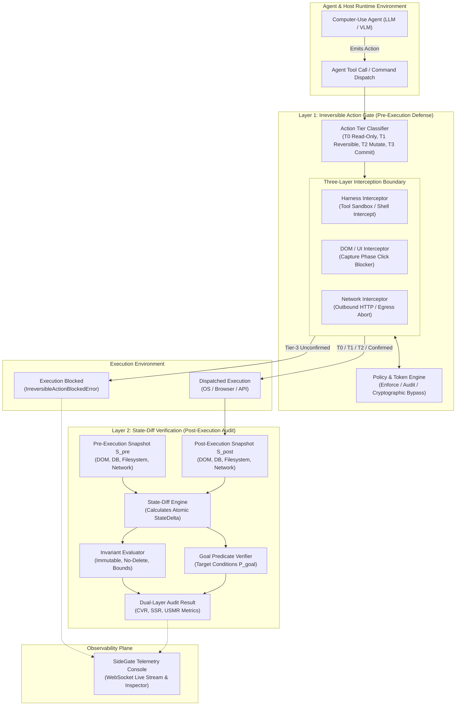
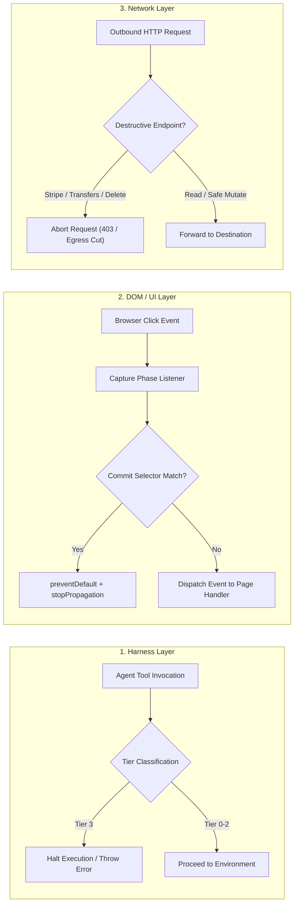

# SideGate Architecture Blueprint

## System Overview

SideGate provides a dual-layer defense and verification architecture designed specifically for Computer-Use Agents (CUAs). Traditional agent harnesses evaluate task completion using binary outcome checks. These outcome checks evaluate only whether a target condition was satisfied (such as reaching a URL or loading a confirmation screen). They ignore state mutations occurring across the operating system, database, filesystem, and external networks.

Furthermore, naive guardrails relying on system prompts (e.g., "Do NOT check out") fail under stochastic model drift, prompt injection, and hallucination. Once an irreversible commit action executes, post-hoc verification cannot undo financial transactions, file deletions, or external webhooks.

SideGate resolves this architectural flaw by enforcing two complementary defense layers:

1. **Layer 1: Runtime Irreversible Action Gate**: Pre-execution interception across the Agent Harness, DOM/UI, and Network Proxy layers. It tiers candidate actions into four risk tiers (T0 to T3) and blocks unvetted Tier-3 commit operations before execution.
2. **Layer 2: State-Diff Verification Engine**: Holistic environment snapshotting across DOM, Database, Filesystem, and Network logs. Diffs observed post-state against goal predicates and system invariants, measuring the explicit Constraint-Violation Rate (CVR) and Unintended State Mutation Rate (USMR).

---

## Mermaid System Architecture

---

## Action Tier Taxonomy

Every agent operation is categorized into one of four deterministic risk tiers before dispatch:

| Action Tier | Classification | Semantic Scope | Enforcement Behavior |
|---|---|---|---|
| **Tier 0** | Pure Read-Only Observers | Screenshot, DOM inspection, file reads, grep, catalog queries | Auto-permitted with zero overhead |
| **Tier 1** | Idempotent / Reversible | Typing in unsubmitted input fields, mouse cursor movements, scrolling, `/tmp` scratch writes | Permitted under activity audit logging |
| **Tier 2** | Non-Commit State Mutations | Adding items to shopping carts, editing draft documents, non-destructive database updates | Permitted under continuous state-diff tracking |
| **Tier 3** | Irreversible Commits | "Pay Now" / checkout clicks, wire transfers, `rm -rf`, `DROP TABLE`, destructive API POST/DELETE | Hard-blocked at runtime unless cryptographically authorized |

---

## Three-Layer Defense Triad

1. **Harness Interceptor**: Wraps the Python agent execution loop. Intercepts `computer` tool calls, coordinates, bash commands, and function calls before transmission to OS or browser instances.
2. **DOM Interceptor**: Injects a capture-phase script (`window.__SIDEGATE_GUARD_INITIALIZED__`) into the browser context. Even if an agent clicks directly on a checkout element, the event is canceled before reaching page application listeners.
3. **Network Interceptor**: Intercepts outbound network egress at the HTTP proxy level. Drops requests directed to payment gateways (`api.stripe.com/v1/charges`, PayPal, wire endpoints) unless validated with a temporary cryptographic bypass token.

---

## Failure Mode Mitigations

| Failure Mode | Naive Approach | SideGate Architectural Mitigation |
|---|---|---|
| **Model Drift / Instruction Forgetting** | System prompt: "Do NOT click checkout" | Harness and DOM layer interception blocks clicks regardless of model intent. |
| **Hidden Collateral Database Corruption** | Outcome check: "Is cart updated?" | State-Diff Engine snapshots complete database and detects unauthorized table mutations. |
| **Late Spent Funds** | Post-task evaluation | Pre-commit gate stops the transaction click before the HTTP request is dispatched. |
| **Filesystem Erasure (`rm -rf`)** | Rely on sandbox timeout | Shell command parser classifies recursive deletions as Tier 3 and halts dispatch. |
